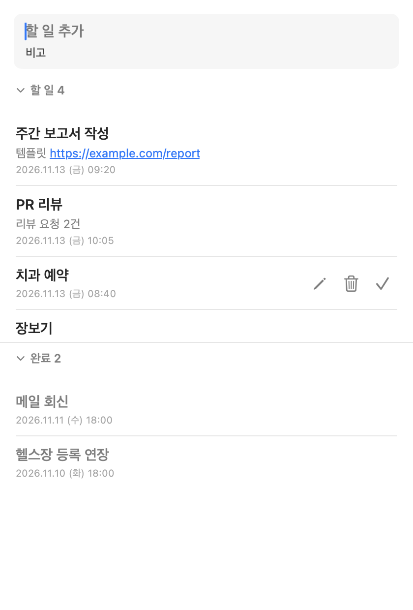
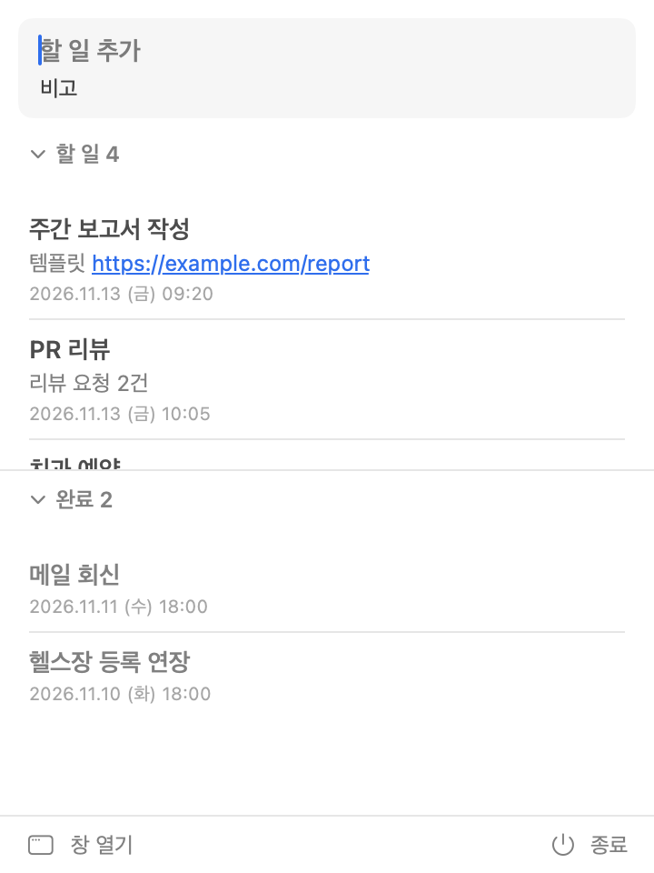

# Todo — 맥 메뉴바 할 일 앱

메뉴바에 머무는 가벼운 macOS 할 일 앱. SwiftUI + AppKit으로 만들었고, Xcode 없이 Command Line Tools만으로 빌드됩니다.

<p>
  
  
</p>

## 다운로드

[**Todo.dmg (최신 버전)**](https://github.com/wndgur2/mac-todo/releases/latest/download/Todo.dmg) · macOS 14 이상 · Apple Silicon / Intel

공증(notarize)되지 않은 앱이라 처음 실행할 때 경고가 뜹니다. **시스템 설정 → 개인정보 보호 및 보안 → 그래도 열기**를 누르거나, 터미널에서 다음을 실행하세요.

```bash
xattr -dr com.apple.quarantine /Applications/Todo.app
```

## 기능
- 제목(+비고) 입력 후 Enter → 바로 추가
- 항목 = 제목(굵게) / 비고(보통) / 생성일(작게)
- 비고 속 URL은 클릭하면 기본 브라우저로 열림
- 드래그로 우선순위 변경
- 할 일 / 완료 섹션을 각각 접고 펼침(헤더 행 클릭). 둘 다 펼치면 높이를 반반
- 행에 마우스를 올리면 편집 · 삭제 · 완료 버튼 (완료 항목은 삭제 · 되돌리기)
- 메뉴바 아이콘(남은 개수 표시) 클릭 → 팝오버로 목록 확인·추가. 창이 열려 있으면 창으로 이동
- 창을 x / ⌘W / ESC로 닫으면 Dock에서 사라지고 메뉴바에만 남음. ⌘Q 또는 메뉴바 → 종료로 완전 종료

## 빌드

```bash
./build.sh            # build/Todo.app (유니버설)
./build.sh install    # /Applications/Todo.app 로 설치
./build.sh dist       # dist/Todo.dmg
```

## 데이터
`~/Library/Application Support/Todo/todos.json` (변경 즉시 저장)

## 디버그 옵션
- `--data <path>` 다른 데이터 파일 사용
- `--snapshot <dir>` 실행 직후 창/팝오버를 PNG로 저장
- `--show-actions` hover 없이 액션 버튼 표시

## 제품 페이지
`site/index.html` (Vercel 정적 배포)
